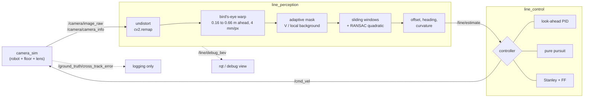
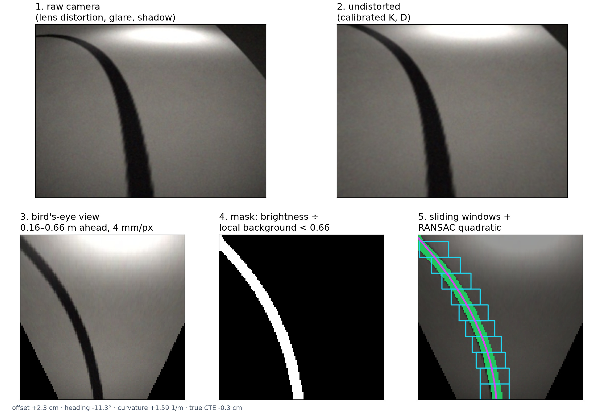
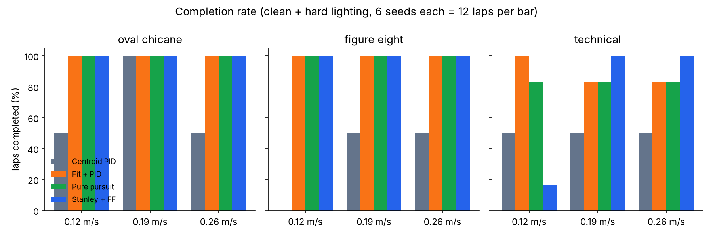
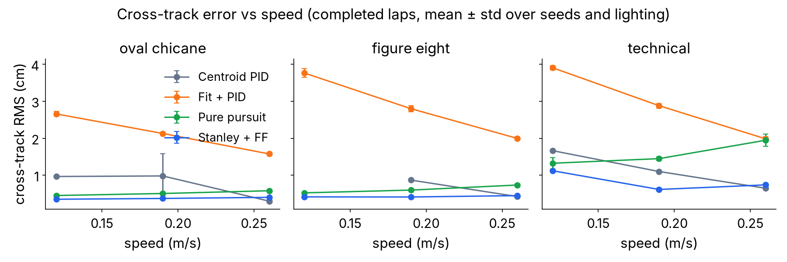
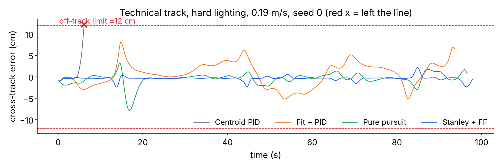
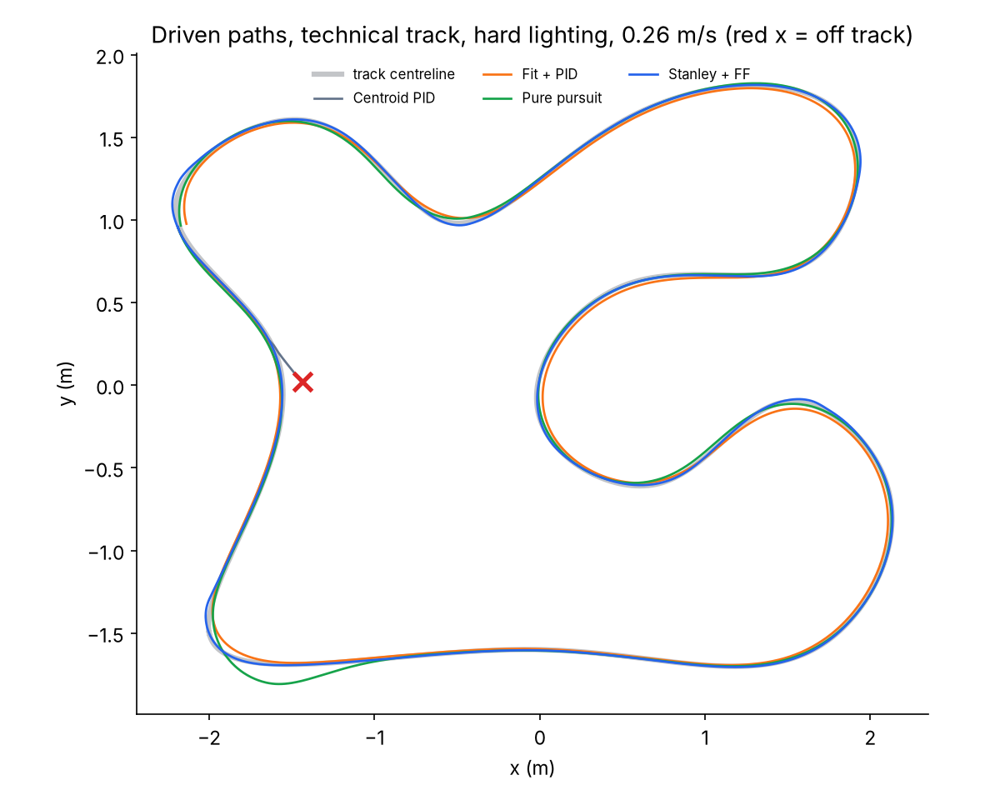
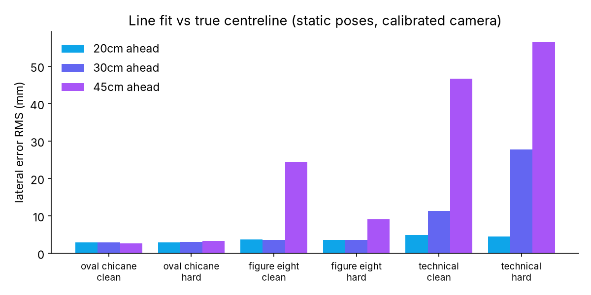
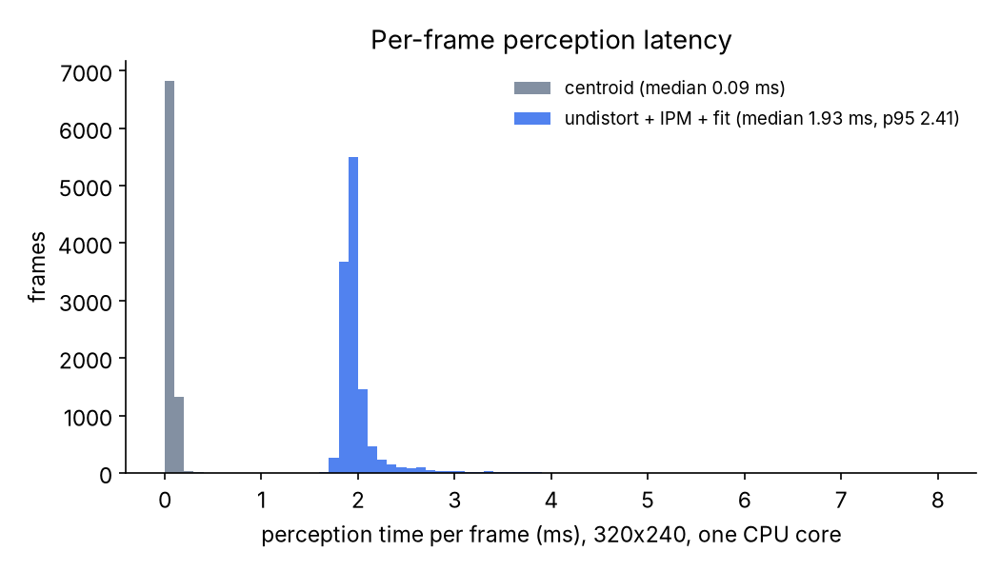
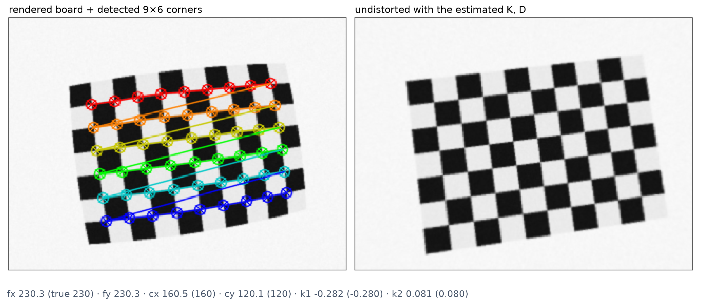

# opencv-line-follower

Camera-based line following for a TurtleBot3 Waffle Pi-style robot, ROS 2 Humble style. I wanted to see how far a proper OpenCV pipeline (calibration, bird's-eye view, sliding windows, RANSAC fit) gets you compared to the usual "threshold + biggest contour + PID" line follower, and whether the steering law still matters once the perception is decent. I ran 4 controllers over 3 tracks, clean and hard lighting, 3 speeds and 3 seeds, so 216 runs, and measured everything against sim ground truth.


https://github.com/user-attachments/assets/72a48c99-5f81-47e5-8465-29738104b1bf


*Stanley + feedforward on the technical track under soft shadows and glare, next to the centroid baseline losing the line on the figure eight.*

## What it is

I don't have the robot in hand right now, so the robot, floor and camera run in a small sim I wrote myself (`line_follower/sim.py`). It uses the Waffle Pi's real numbers: 0.287 m wheel base, 33 mm wheels, 0.26 m/s and 1.82 rad/s max, and when a wheel saturates I scale both down so the curvature stays the same. The camera is a simulated pinhole + barrel-distortion lens on a mast at the front edge, 0.20 m up, tilted down 45°. There's no Gazebo and no physics beyond diff-drive kinematics with wheel speed limits.

Everything after the camera image is real OpenCV code that would run the same on a real camera feed, split into three ROS 2 nodes.

## Pipeline




There's no MPC in here. The centroid baseline skips the bird's-eye/RANSAC part and uses its own threshold + biggest contour.



- **Calibrate.** 25 checkerboard views, 20 detected, reprojection RMS 0.14 px. Undistorting with my estimate vs the true lens gives 0.66 px mean error.
- **Undistort.** `cv2.remap` with maps built once from the calibration.
- **Bird's-eye warp.** The floor 0.16 to 0.66 m ahead becomes a 125x125 top view, 4 mm per pixel.
- **Adaptive mask.** A fixed threshold dies under shadows, so I divide the V channel by a local background (grey closing that removes the thin line but keeps the shadow) and threshold that ratio. Glare isn't darker than its surroundings so it mostly drops out, and tiny blobs go through an area filter.
- **Sliding windows + RANSAC.** Windows walk up from the bottom, then a RANSAC quadratic in floor coordinates.
- **Offset, heading, curvature.** Read off the fit at a 30 cm look-ahead and sent as one `Float32MultiArray`.

ROS 2 graph, short form:

```
/camera_sim      pub  /camera/image_raw, /camera/camera_info, /ground_truth/cross_track_error   sub /cmd_vel
/line_perception sub  /camera/image_raw        pub /line/estimate, /line/debug_bev
/line_control    sub  /line/estimate           pub /cmd_vel
```

## Controllers

All four get the same speed and the same wheel limits.

- **Centroid PID (baseline).** Threshold, biggest contour, centroid of a region of interest, PID on the pixel offset. What most line follower tutorials do.
- **Fit + look-ahead PID.** PID on the lateral offset of the fitted line at 30 cm.
- **Fit + pure pursuit.** Arc through a look-ahead point on the fitted line, curvature = 2y / (x² + y²). The look-ahead grows with speed.
- **Fit + Stanley + feedforward.** ω = v·κ + k_h·heading + k_e·atan(k·e / (v + v0)), with v0 = 0.15.

## Results

3 tracks x clean/hard lighting x 0.12/0.19/0.26 m/s x 4 controllers x 3 seeds = 216 runs. "Hard" means soft cast shadows (blurred, partial, the line stays visible through them), glare spots from ceiling lights and a slow brightness swing. A run fails if the robot gets 12 cm off the true centreline. All numbers are from `results/summary.csv` and `results/results_table.md`.

| Controller | Laps done | Clean | Hard light | CTE RMS (cm) | CTE max (cm) | Heading RMS (°) | Perception (ms) |
|---|---|---|---|---|---|---|---|
| Centroid PID (baseline) | 27/54 | 24/27 | 3/27 | 0.88 | 11.2 | 1.7 | 0.09 |
| Fit + look-ahead PID | 52/54 | 27/27 | 25/27 | 2.64 | 10.5 | 2.5 | 1.93 |
| Fit + pure pursuit | 51/54 | 27/27 | 24/27 | 0.86 | 12.0 | 1.9 | 1.92 |
| Fit + Stanley + FF | 49/54 | 25/27 | 24/27 | 0.48 | 8.8 | 1.0 | 1.93 |

Errors are for completed laps only. On the 8 cases that all four finished on every seed, Stanley + FF averaged 0.47 cm RMS vs 2.27 cm for the look-ahead PID, 0.84 for pure pursuit and 0.78 for the baseline. Perception time is on one CPU core of my dev machine.

Static perception check (robot placed on the true centreline): lateral error is about 3 to 5 mm RMS at 20 cm ahead, but 47 to 57 mm at 45 cm on the technical track's tight curves. That's why the look-ahead sits at 30 cm.









## What broke

- **The baseline only finished 3 of 27 hard-lighting laps.** It finishes 24 of 27 clean ones, so it's not the PID. A fixed threshold picks up shadow edges and the biggest contour isn't always the line.
- **Technical track, hard lighting, seed 1:** the fit-based controllers leave the line at almost the same spot (about 38% of the lap) in 6 of 9 runs. All three fail at the same place, so it's a perception problem, not a steering one. That's where a dashed stretch overlaps the lighting disturbances. Not fixed yet.
- **Stanley at 0.12 m/s on the technical track** finished only 1 of 6, mostly going off around 16% of the lap. Faster was actually better for it (6/6 at 0.19 and 0.26). I haven't pinned down why. My guess is the offset term: it's atan(k*e/(v+v0)), so at low speed the gain goes up and it may be over-correcting, but I haven't proven it.
- **Runs weren't reproducible at first.** I cached the World object per worker to save time, and its camera-noise random generator carried over between runs. So the same seed gave a different lap depending on which runs that worker did before. One Stanley run went from "off track at 88%" to "completed" once I reset the generator every lap. Now the video recordings and the matrix give the same result for the same seed.
- Early on I put the camera mast at the middle of the plate, and the camera would have been looking at its own robot. I moved it to the front edge and shifted the bird's-eye window.
- My first shadow model was hard black polygons. They looked like obstacles and weren't realistic, so I replaced them with soft partial shadows and re-ran all 216 runs (again after the seed fix). The numbers above are from the soft-shadow floor only.

## Repo layout

```
line_follower/      camera model, calibration, perception, controllers, sim, track generator
line_follower/nodes camera_sim, line_perception, line_control (ROS 2 nodes)
launch/             line_follower.launch.py
config/             params.yaml
experiments/        calibrate_camera.py, run_experiments.py, perception_accuracy.py, analyze.py
results/            summary.csv (one row per run), results_table.md, calibration.json, accuracy data
logs/               per-run CSV logs (pose, cross-track error, latency for every frame)
plots/              all the charts above
video/              recording + 3D render scripts for the demo video
tests/              pytest
ci/                 GitHub Actions workflow (copy to .github/workflows/ to turn it on)
```

## How to run

```bash
pip install -r requirements.txt
python3 -m pytest -q                       # 13 tests
python3 experiments/calibrate_camera.py
python3 experiments/run_experiments.py     # ~11 min on 6 cores
python3 experiments/perception_accuracy.py
python3 experiments/analyze.py
```

With ROS 2 Humble sourced:

```bash
colcon build && source install/setup.bash
ros2 launch line_follower line_follower.launch.py
```

## Honest limits

- It's all in my own sim. No real camera, no real floor, no motor dynamics or wheel slip. The lens, shadows and glare are my models of those things.
- Errors are measured against sim ground truth, which a real robot wouldn't give me for free.
- 3 seeds per cell is small. A couple of laps either way would move the completion numbers.
- The controllers were tuned by hand on the same tracks they were tested on.
- Next thing I want is to run the perception node on a real camera feed and see how much of this survives.

Shanmukh Narayana Chaganti, BTech Robotics & AI, Amrita School of Engineering, Bengaluru
